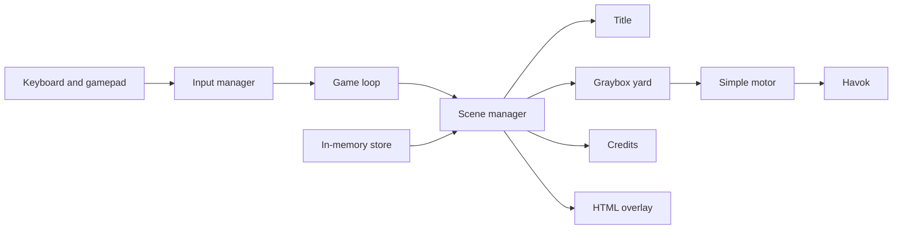

# Architecture

Chaos Garden is a browser game. Milestone M0 keeps the pieces small: a renderer bootstrap, an input layer, a scene switcher, an in-memory store, and a gray-box yard. Later milestones fill in movement, levels, pets, and the garden. Nothing is written to disk. Refreshing the page clears the store.

The title string lives only in `GAME_TITLE` inside `src/config.ts`.

## Modules

| Path          | Role                                                                                     |
| ------------- | ---------------------------------------------------------------------------------------- |
| `src/core`    | Engine bootstrap, fixed-cap game loop, scene manager, in-memory store                    |
| `src/input`   | Keyboard and Gamepad API mapped to named actions, with deadzones and remappable bindings |
| `src/player`  | Placeholder hero mesh and the simple run-and-jump motor                                  |
| `src/levels`  | Gray-box yard geometry                                                                   |
| `src/pets`    | Pure TypeScript growth and temperament rules. This folder must not import the renderer   |
| `src/garden`  | Names of the light, neutral, and dark gardens                                            |
| `src/ui`      | HTML overlay: title, HUD, pause menu, credits                                            |
| `src/audio`   | Silent bus until cues exist                                                              |
| `src/scenes`  | Title, yard, and credits scenes that the scene manager swaps                             |
| `src/content` | Asset manifest types and the credits markdown renderer                                   |

## Data flow

Each frame the engine asks the input manager for a snapshot. The manager reads the keyboard, the pointer, and `navigator.getGamepads()`, then a pure function turns that snapshot into an `InputFrame`. The game loop caps the step at 50 ms and hands the frame to the scene manager.

The scene manager owns one active scene. A scene may request another id; the switch happens after the current update, so a scene is never disposed mid-update. Switching resets the paused flag and updates the store. The store notifies nothing on its own beyond subscribers: there is no save file and no network.

The yard scene is the only one that turns on physics. It builds static boxes, drops the placeholder hero in, and sets linear velocity from the motor. The follow camera orbits that body. The real momentum controller replaces this motor later; the input frame stays the same.

The overlay reads the active scene, the device label, and the frame rate. The pause menu reads the current binding table, so a remapped key shows up without a second list. The credits screen and `CREDITS.md` both come from `assets/manifest.json`.

Pet rules and garden names are not simulated yet. They sit behind the renderer so unit tests can run them without WebGL. ESLint rejects a renderer import under `src/pets`.
